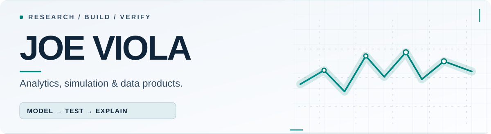
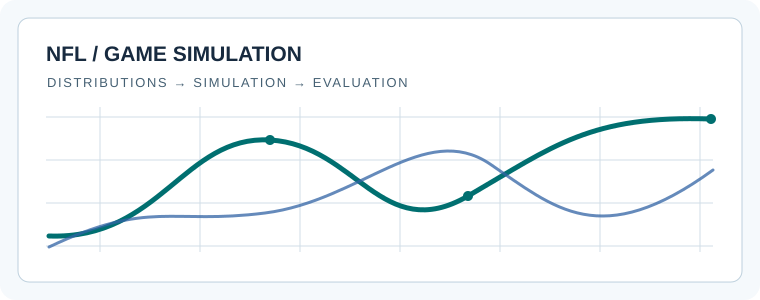
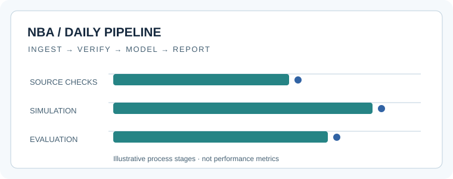
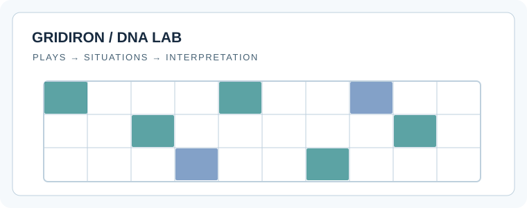
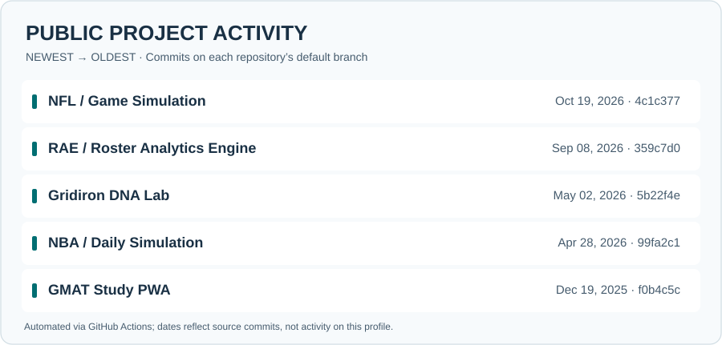

<!--
  Joe Viola — GitHub-native analytics portfolio
  Intentional constraints: no JavaScript, iframes, remote tracking widgets, fake
  performance claims, fixed-width tables, or animations required for content.
  Visuals and research notes render directly in the GitHub profile README.
-->

<picture>
  <source media="(prefers-color-scheme: dark)" srcset="./assets/profile-dark.svg">
  <source media="(prefers-color-scheme: light)" srcset="./assets/profile-light.svg">
  
</picture>

<strong>Business analytics · Predictive modeling · Data products</strong>

MBA candidate at the University of Mississippi. I build research tools, simulations, and dashboards that turn complicated data into something people can actually use.

  <a href="#selected-work"><strong>Explore the work ↓</strong></a>
  &nbsp;·&nbsp;
  <a href="#research-notes">Research notes</a>
  &nbsp;·&nbsp;
  <a href="#project-pulse">Project pulse</a>
  &nbsp;·&nbsp;
  <a href="https://github.com/jviola1019?tab=repositories">All repositories ↗</a>

  
  
  
  
  

---

## Selected work

Projects chosen to show the range of what I build: statistical modeling, reusable research pipelines, and interfaces designed for real decisions.

01 / FEATURED PRODUCT · SIMULATION + UI

### [RAE — Roster Analytics Engine ↗](https://github.com/jviola1019/fantasy_football_dashboard)

**Fantasy football research in a working product interface.** RAE brings league insights, player comparisons, and probabilistic season scenarios together in a dashboard—so exploring a question doesn't require digging through disconnected spreadsheets.

**Built with:** Next.js · TypeScript · Tailwind CSS · Simulation  
**Explore:** [Source & screenshots](https://github.com/jviola1019/fantasy_football_dashboard) · [Architecture & methods](https://github.com/jviola1019/fantasy_football_dashboard#architecture-overview)

<strong>Research result: the hypothesis that didn't hold up</strong>

The original idea was that a measurable gap between perceived and actual player value could identify draft opportunities. An out-of-sample test covering **115 real drafts did not support that claim**. The project moved away from presenting a reputation-arbitrage edge instead of ignoring the evidence.

[Read the frozen holdout result and limitations ↗](https://github.com/jviola1019/fantasy_football_dashboard/blob/main/reports/2026-08-20/holdout-result-3.md)

---

02 / PROBABILITY + MODEL EVALUATION

### [NFL Game Prediction Model ↗](https://github.com/jviola1019/nfl_weekly_simulation)

A research-stage simulator for NFL game outcomes, with statistical score distributions, game-level simulations, and comparisons against market-based baselines.

<a href="https://github.com/jviola1019/nfl_weekly_simulation">
  <picture>
    <source media="(prefers-color-scheme: dark)" srcset="./assets/nfl-dark.svg">
    <source media="(prefers-color-scheme: light)" srcset="./assets/nfl-light.svg">
    
  </picture>
</a>

**Built with:** R · Monte Carlo simulation · Backtesting  
**Research status:** Performance is **not yet validated**; the repository explicitly documents withdrawn or unverified claims.  
[Explore model & documentation ↗](https://github.com/jviola1019/nfl_weekly_simulation) · [Evidence ledger ↗](https://github.com/jviola1019/nfl_weekly_simulation/blob/main/docs/EVIDENCE_LEDGER.md)

<strong>What I check before trusting a prediction</strong>

- Whether a model beats a meaningful baseline **out of sample**, not just on historical fitting.
- Whether probability forecasts are calibrated and evaluated with appropriate scoring rules.
- Whether claims are traceable to a repeatable experiment.

The repository's evidence ledger distinguishes validated, reproducible, unvalidated, and withdrawn claims. It is the source of truth for current model status.

---

03 / RESEARCH PIPELINE + REPORTING

### [NBA Daily Monte Carlo ↗](https://github.com/jviola1019/nba_daily_simulation)

A repeatable basketball research pipeline that brings together game and player data, simulations, data-quality safeguards, and reporting.

<a href="https://github.com/jviola1019/nba_daily_simulation">
  <picture>
    <source media="(prefers-color-scheme: dark)" srcset="./assets/nba-dark.svg">
    <source media="(prefers-color-scheme: light)" srcset="./assets/nba-light.svg">
    
  </picture>
</a>

**Built with:** R · Data pipelines · Monte Carlo methods  
**Focus:** Consistent runs, time-aware evaluation, and making missing or stale inputs explicit.  
[Explore the pipeline ↗](https://github.com/jviola1019/nba_daily_simulation)

<strong>Why the pipeline matters</strong>

A prediction is only one part of a usable research product. Data freshness, reproducible inputs, and clear reporting also matter. The repository documents its source checks and evaluation workflows; it does not establish a general claim of profitable predictions.

---

04 / INTERACTIVE EXPLORATION

### [Gridiron DNA Lab ↗](https://github.com/jviola1019/shiny_predictive_football_app)

An interactive R Shiny application for examining NFL and college football offensive tendencies, situational efficiency, and field-position patterns.

<a href="https://github.com/jviola1019/shiny_predictive_football_app">
  <picture>
    <source media="(prefers-color-scheme: dark)" srcset="./assets/gridiron-dark.svg">
    <source media="(prefers-color-scheme: light)" srcset="./assets/gridiron-light.svg">
    
  </picture>
</a>

**Built with:** R · Shiny · Play-by-play data · Visual analytics  
**Explore:** [Application source & setup ↗](https://github.com/jviola1019/shiny_predictive_football_app)

---

05 / LEARNING PRODUCT + FRONT-END UX

### [GMAT Study PWA ↗](https://github.com/jviola1019/gmat_quant_pwa)

A browser-based study app with guided quantitative practice, flashcards, worked solutions, and offline support. It's a different kind of project, but it involves the same challenge: turning complicated information into an interface people want to use.

  

**Built with:** JavaScript · Progressive Web App · Responsive UI  
[Explore app & features ↗](https://github.com/jviola1019/gmat_quant_pwa)

---

## Research notes

These are not win-rate claims or marketing metrics. They're direct links to the research and quality checks behind the projects.

- **[RAE: frozen out-of-sample holdout](https://github.com/jviola1019/fantasy_football_dashboard/blob/main/reports/2026-08-20/holdout-result-3.md)** — the original edge hypothesis did not survive testing.
- **[NFL: evidence ledger](https://github.com/jviola1019/nfl_weekly_simulation/blob/main/docs/EVIDENCE_LEDGER.md)** — explicit status for model-performance claims.
- **[NBA: evaluation and audit workflow](https://github.com/jviola1019/nba_daily_simulation)** — reproducibility and input-quality checks.

<strong>Live engineering checks · expand to see workflow statuses</strong>

These are **live CI workflow badges**, not badges claiming model accuracy. A failed or missing check is shown as such by GitHub.

| Project | CI / quality workflow |
| :-- | :-- |
| [RAE](https://github.com/jviola1019/fantasy_football_dashboard) |  |
| [NFL simulation](https://github.com/jviola1019/nfl_weekly_simulation) |  |
| [NBA simulation](https://github.com/jviola1019/nba_daily_simulation) |  |
| [Gridiron DNA Lab](https://github.com/jviola1019/shiny_predictive_football_app) |  |

## Project pulse

The graphic below lists five public repositories by their latest commit timestamps, **newest first**. The profile repository's [refresh workflow](https://github.com/jviola1019/jviola1019/actions/workflows/profile-activity.yml) is configured to check for updates twice weekly and on manual request, then update this SVG only when the source commits change.

<picture>
  <source media="(max-width: 600px) and (prefers-color-scheme: dark)" srcset="./assets/activity-mobile-dark.svg">
  <source media="(max-width: 600px) and (prefers-color-scheme: light)" srcset="./assets/activity-mobile-light.svg">
  <source media="(prefers-color-scheme: dark)" srcset="./assets/activity-dark.svg">
  <source media="(prefers-color-scheme: light)" srcset="./assets/activity-light.svg">
  
</picture>

Built from public GitHub commit metadata. The graphic is a source-activity summary, not a productivity ranking or proof of model quality. [Review the update script ↗](./scripts/render_activity.py)

  
  

---

<strong>Want to see the actual work?</strong>

<a href="https://github.com/jviola1019/fantasy_football_dashboard">Start with RAE</a> &nbsp;·&nbsp; <a href="https://github.com/jviola1019?tab=repositories">Browse public repositories</a>

Real projects · Transparent limitations · Work in progress

