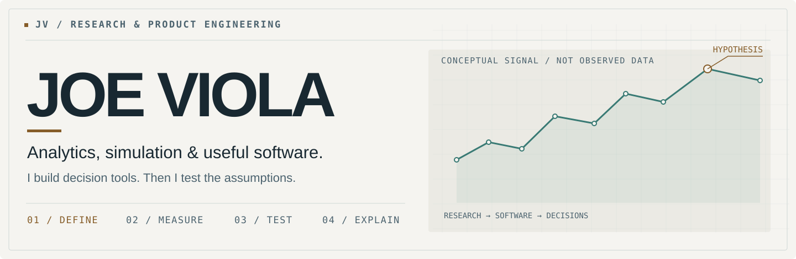
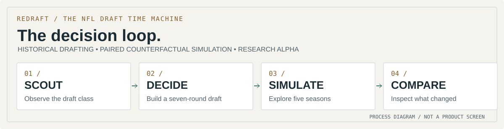
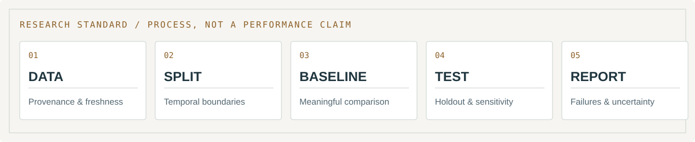
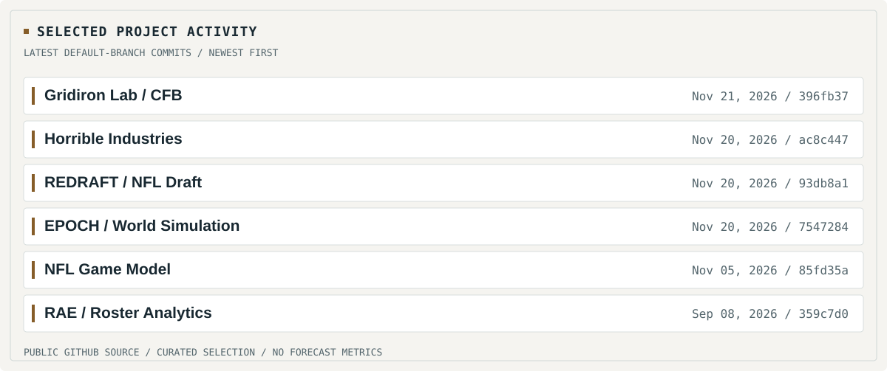

<!--
  GitHub-native editorial portfolio.
  Images labeled as screenshots come from source repositories; editorial SVGs
  are explicitly conceptual. No private projects, tracking scripts, fabricated
  performance data, or unsupported browser interactivity.
-->

<picture>
  <source media="(prefers-color-scheme: dark)" srcset="./assets/profile-dark.svg">
  <source media="(prefers-color-scheme: light)" srcset="./assets/profile-light.svg">
  
</picture>

<strong>Business analytics · Statistical modeling · Simulation systems</strong>

MBA candidate at the University of Mississippi. I build applications that help people explore decisions, then document what the data can—and cannot—support.

  <a href="#selected-work">Selected work</a> &nbsp;·&nbsp;
  <a href="#research-standard">Research standard</a> &nbsp;·&nbsp;
  <a href="#project-activity">Project activity</a> &nbsp;·&nbsp;
  <a href="https://github.com/jviola1019?tab=repositories">All repositories</a>

---

## Selected work

01 — PRODUCT ENGINEERING / ANALYTICS

### [RAE — Roster Analytics Engine](https://github.com/jviola1019/fantasy_football_dashboard)

**A working fantasy-football analytics product**, combining league intelligence, player analysis and probabilistic season scenarios in a deliberately organized interface.

**Engineering:** Next.js · TypeScript · SQL · data pipelines · simulation · product UI

**Evidence worth examining:** A preregistered-style frozen holdout across **115 real drafts** did **not** establish the original reputation-arbitrage hypothesis. The study documents the failed within-position test rather than advertising a nonexistent edge.

[Product & architecture](https://github.com/jviola1019/fantasy_football_dashboard#architecture-overview) · [Original holdout and limitations](https://github.com/jviola1019/fantasy_football_dashboard/blob/main/reports/2026-08-20/holdout-result-3.md) · [CI workflow](https://github.com/jviola1019/fantasy_football_dashboard/actions/workflows/ci.yml)

---

02 — INTERACTIVE SIMULATION / HISTORICAL RECONSTRUCTION

### [REDRAFT — The NFL Draft Time Machine](https://github.com/jviola1019/redraft)

**Draft the past. Explore the alternate history.** A seven-round historical NFL draft simulator with scouting, CPU decisions, trades and paired five-season simulations.

<picture>
  <source media="(prefers-color-scheme: dark)" srcset="./assets/feature-redraft-dark.svg">
  <source media="(prefers-color-scheme: light)" srcset="./assets/feature-redraft-light.svg">
  
</picture>

**Engineering:** TypeScript · simulation engines · historical datasets · scenario reconstruction · testing

**Release state:** Playable **research alpha**, not a statistically cleared production model. The release evidence reports substantive unresolved calibration and source-coverage limitations.

[Source & local setup](https://github.com/jviola1019/redraft) · [Current release evidence](https://github.com/jviola1019/redraft/blob/main/docs/release/CURRENT_RELEASE.md) · [Coverage manifest](https://github.com/jviola1019/redraft/blob/main/data/processed/scenario-coverage.json)

---

03 — COLLEGE FOOTBALL / MODELING &amp; DATA ENGINEERING

### [Gridiron Lab — Hypothetical College Football](https://github.com/jviola1019/hypothetical_cfb)

A two-tab football research application for **game simulations** and **playoff scenarios**. It separates sourced team and player records, experimental prediction evaluations and simulated outcomes. The current research includes retrospective score-interval and player-event evaluations.

**Engineering:** JavaScript · Python · NCAA-format rules-as-data · data provenance · distribution testing

**Research boundary:** A conditional player-event study is **not** independently calibrated, unconditional player-prop forecasting. Historical inputs and simulated outcomes are deliberately labeled separately.

[Repository](https://github.com/jviola1019/hypothetical_cfb) · [Model card](https://github.com/jviola1019/hypothetical_cfb/blob/main/docs/MODEL_CARD.md) · [Validation](https://github.com/jviola1019/hypothetical_cfb/blob/main/docs/VALIDATION_V08.md)

---

04 — SYSTEMS DESIGN / EMERGENT SIMULATION

### [EPOCH — Civilizations Unbound](https://github.com/jviola1019/worldsim)

A browser-based pixel-world simulator with procedural terrain, nations, eras, diplomacy, cities and individual histories. A different product category, but the same engineering challenge: make a complex evolving system understandable and explorable.

**Engineering:** browser simulation · procedural generation · deterministic states · responsive UX

[Explore the game](https://github.com/jviola1019/worldsim) · [Visual documentation](https://github.com/jviola1019/worldsim/blob/7547284b9f05576f37e9589194a07c418393c3ef/README.md) · [Verification notes](https://github.com/jviola1019/worldsim/blob/7547284b9f05576f37e9589194a07c418393c3ef/docs/VALIDATION.md)

---

### More projects

**[Horrible Industries](https://github.com/jviola1019/horrible_ceo)** — An offline-first, satirical CEO strategy game with a modeled business system. Its economics are fictional rather than empirically calibrated. [Source artwork](https://github.com/jviola1019/horrible_ceo/blob/main/assets/office.svg).

**[NFL Game Prediction Model](https://github.com/jviola1019/nfl_weekly_simulation)** — An R-based simulation and evaluation framework. Predictive performance is not yet independently established. [Evidence ledger](https://github.com/jviola1019/nfl_weekly_simulation/blob/main/docs/EVIDENCE_LEDGER.md).

**[NBA Daily Monte Carlo](https://github.com/jviola1019/nba_daily_simulation)** — Game and player modeling, reproducible reporting and data-freshness safeguards. Research software; not a documented profit-making strategy.

**[Gridiron DNA Lab](https://github.com/jviola1019/shiny_predictive_football_app)** — An R Shiny visual-analysis tool for football play-by-play tendencies and situational patterns.

---

## Research standard

The most useful outputs are not always favorable results. A model is only as credible as its input provenance, evaluation design and documentation of failure modes.

<picture>
  <source media="(prefers-color-scheme: dark)" srcset="./assets/methods-dark.svg">
  <source media="(prefers-color-scheme: light)" srcset="./assets/methods-light.svg">
  
</picture>

- **Evidence before headlines.** [RAE's holdout](https://github.com/jviola1019/fantasy_football_dashboard/blob/main/reports/2026-08-20/holdout-result-3.md) does not support the headline edge; the conclusion says so.
- **Verification before release.** [REDRAFT's release record](https://github.com/jviola1019/redraft/blob/main/docs/release/CURRENT_RELEASE.md) keeps statistical gates open even when structural tests pass.
- **Source and simulation are different.** [Gridiron Lab's model card](https://github.com/jviola1019/hypothetical_cfb/blob/main/docs/MODEL_CARD.md) explains observational, retrospective and hypothetical outputs.

<strong>Engineering checks and research artifacts</strong>

Workflow badges report **build and test status**, not forecast accuracy or real-world profitability.

- [RAE CI](https://github.com/jviola1019/fantasy_football_dashboard/actions/workflows/ci.yml)
- [NFL model evidence ledger](https://github.com/jviola1019/nfl_weekly_simulation/blob/main/docs/EVIDENCE_LEDGER.md)
- [NBA audit workflow](https://github.com/jviola1019/nba_daily_simulation/actions/workflows/audits.yml)
- [Profile source and asset checks](https://github.com/jviola1019/jviola1019/actions/workflows/readme-check.yml)

---

## Project activity

The graphic tracks the **six most recently updated projects within a curated list of public repositories**, by latest default-branch commit timestamp. It is not a complete account-wide activity feed or a ranking of research quality.

<picture>
  <source media="(max-width: 600px) and (prefers-color-scheme: dark)" srcset="./assets/activity-mobile-dark.svg">
  <source media="(max-width: 600px) and (prefers-color-scheme: light)" srcset="./assets/activity-mobile-light.svg">
  <source media="(prefers-color-scheme: dark)" srcset="./assets/activity-dark.svg">
  <source media="(prefers-color-scheme: light)" srcset="./assets/activity-light.svg">
  
</picture>

Generated from public commit metadata using [the project manifest](./data/projects.json) and [the refresh script](./scripts/render_activity.py). [Source and screenshot provenance](./docs/PORTFOLIO_AUDIT.md). Refreshes are scheduled; the graphic may lag recent commits.

---

<strong>Interested in the implementation?</strong>

<a href="https://github.com/jviola1019?tab=repositories">Browse all public repositories</a> &nbsp;·&nbsp; <a href="https://github.com/jviola1019/fantasy_football_dashboard">Start with RAE</a> &nbsp;·&nbsp; <a href="https://github.com/jviola1019/redraft">Explore REDRAFT</a>

Applied analytics / reproducible research / original software

